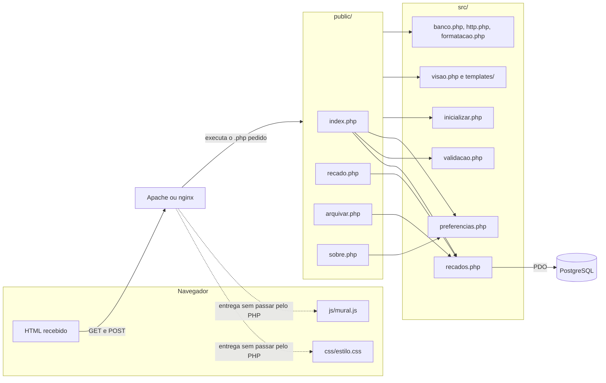

# Estrutura de pastas

A estrutura separa o que o navegador pode pedir (`public/`) do que só o PHP lê
(`src/`, `config.php`). Essa é a única fronteira que o projeto impõe; dentro de
`src/`, os arquivos se dividem por assunto.

## Diagrama

```mermaid
flowchart TD
    raiz["mini-mural/"]

    raiz --> public["public/ (raiz de documentos do servidor web)"]
    raiz --> src["src/ (só o PHP lê)"]
    raiz --> servidor["servidor/"]
    raiz --> sql["sql/"]
    raiz --> docs["docs/"]
    raiz --> tests["tests/"]
    raiz --> config["config.php (local, fora do Git)"]
    raiz --> exemplo["config.exemplo.php"]
    raiz --> compose["compose.yaml: serviços app e banco"]
    raiz --> docker["docker/"]

    public --> index["index.php: mural e publicar"]
    public --> recado["recado.php: detalhe"]
    public --> arquivar["arquivar.php: ação de arquivar"]
    public --> sobre["sobre.php: descrição e ordem"]
    public --> css["css/estilo.css"]
    public --> js["js/mural.js"]

    src --> inicializar["inicializar.php: carrega tudo"]
    src --> banco["banco.php: conexão PDO"]
    src --> recados["recados.php: todo o SQL"]
    src --> validacao["validacao.php: regra do texto"]
    src --> preferencias["preferencias.php: cookie da ordem"]
    src --> formatacao["formatacao.php: datas"]
    src --> http["http.php: POST, id, redirecionar"]
    src --> visao["visao.php: escape e templates"]
    src --> templates["templates/: cabeçalho, rodapé, 404, erro"]

    servidor --> apache["apache.conf: Apache com mod_php"]
    servidor --> nginx["nginx.conf: nginx com PHP-FPM"]

    docker --> dockerfile["Dockerfile: imagem do app"]
    docker --> dapache["apache.conf: site no contêiner"]
    docker --> dconfig["config.php: lê o ambiente"]

    sql --> schema["schema.sql"]
    sql --> seed["seed.sql"]

    classDef servida fill:#dbeafe,stroke:#1d4ed8
    classDef privada fill:#f5f5f4,stroke:#57534e
    class public,index,recado,arquivar,sobre,css,js servida
    class src,inicializar,banco,recados,validacao,preferencias,formatacao,http,visao,templates,config privada
```

Em azul, o que o navegador alcança por endereço. Em cinza, o que só o PHP lê.

## Quem usa quem

As páginas de `public/` dependem de `src/`. Nenhum arquivo de `src/` inclui uma
página, e só `recados.php` escreve SQL.

## O que mora em cada arquivo

| Arquivo | Conteúdo | Muda quando |
|---|---|---|
| `public/index.php` | Lê o POST do formulário, chama a validação, grava, lista e desenha o mural | A tela do mural muda |
| `public/recado.php` | Valida o `id`, busca o recado e desenha o detalhe ou o 404 | A tela de detalhe muda |
| `public/arquivar.php` | Exige POST, arquiva e redireciona | O destino depois de arquivar muda |
| `public/sobre.php` | Mostra a descrição e grava a ordem no cookie | A tela Sobre muda |
| `public/css/estilo.css` | Cores, espaços e tamanhos, definidos como variáveis CSS no topo | A aparência muda |
| `public/js/mural.js` | Contador de caracteres e aviso de erro antes do envio | O comportamento do formulário no navegador muda |
| `src/inicializar.php` | Carrega `config.php`, fuso, funções e o tratador de exceção | Entra um arquivo novo em `src/` |
| `src/banco.php` | `conectarAoBanco()` | A forma de conectar muda |
| `src/recados.php` | Todo o SQL de recados e `resumirRecados()` | Uma consulta muda |
| `src/validacao.php` | `validarRecado()`, `LIMITE_DO_RECADO` e `normalizarQuebrasDeLinha()` | A regra do texto muda |
| `src/preferencias.php` | `lerOrdem()`, `salvarOrdem()` e a lista `ORDENS` | Surge outra preferência ou outra ordem |
| `src/formatacao.php` | Conversão de fuso e formatos de hora | O formato das datas muda |
| `src/http.php` | `lerCampo()`, `lerId()`, `exigirPost()` e `redirecionar()` | A leitura do pedido muda |
| `src/visao.php` | `e()`, `plural()`, `cabecalho()`, `rodape()` e `recadoNaoEncontrado()` | O esqueleto das páginas muda |
| `src/templates/` | Topo com navegação, rodapé, página 404 e página de erro | O esqueleto das páginas muda |
| `servidor/apache.conf` | Site do Apache: porta, `DocumentRoot` em `public/` e logs | A pasta ou a porta do site muda |
| `servidor/nginx.conf` | Site do nginx: porta, `root` em `public/` e repasse ao PHP-FPM | A pasta, a porta ou o socket do PHP-FPM muda |
| `sql/schema.sql` | Tabela, restrições e índice | O modelo de dados muda |
| `sql/seed.sql` | Os três recados de exemplo | Os exemplos mudam |
| `tests/regras_test.php` | Testes das funções que não usam banco | Uma regra muda |
| `config.exemplo.php` | Modelo da configuração local | Entra uma configuração nova |
| `compose.yaml` | Os serviços `app` e `banco`, a porta 8081, as variáveis de ambiente e o volume de dados | Entra um serviço ou muda uma senha de desenvolvimento |
| `docker/Dockerfile` | Imagem do `app`: `php:8.4-apache`, `pdo_pgsql`, site e código | Muda a versão do PHP ou entra uma extensão |
| `docker/apache.conf` | Site do Apache no contêiner, com os logs na saída do contêiner | A configuração do site muda |
| `docker/config.php` | Configuração lida das variáveis de ambiente | Entra uma chave nova no `config.exemplo.php` |
| `.dockerignore` | O que fica fora da imagem, como o `config.php` local | Surge outro arquivo que não deve ir para a imagem |
