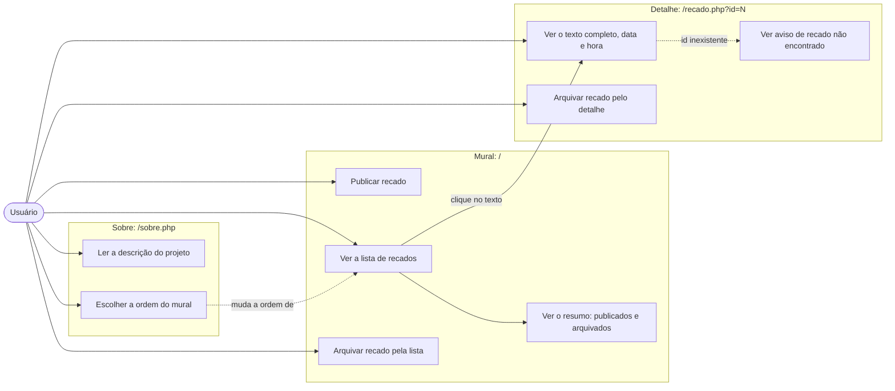
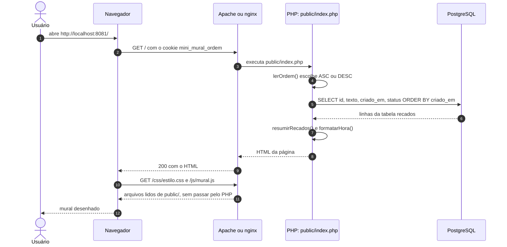
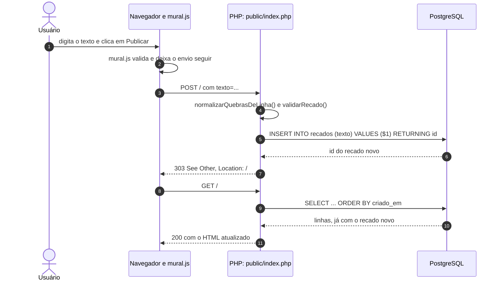
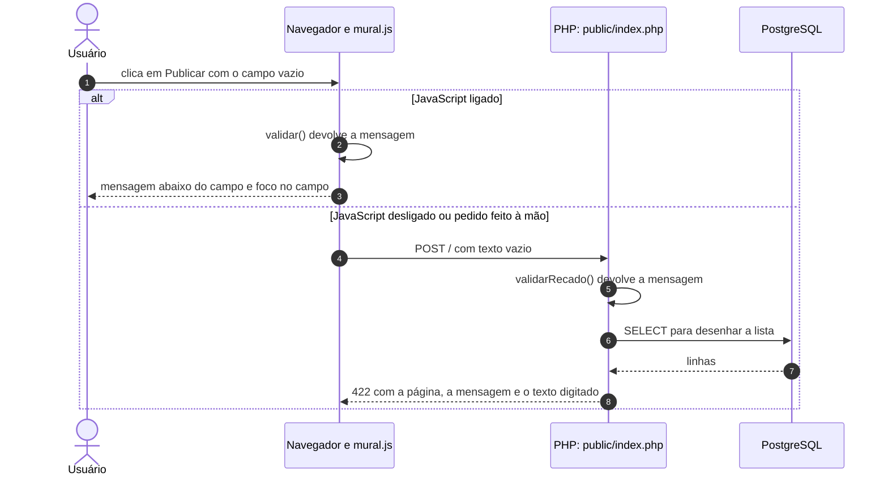
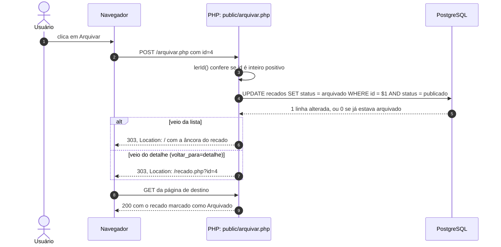
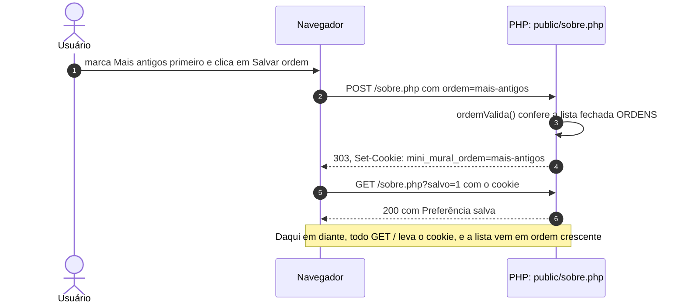
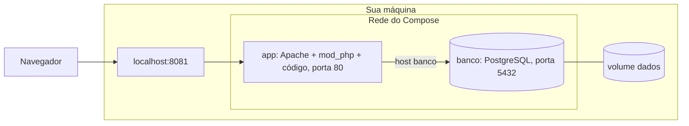

# Como a aplicação funciona

Este documento descreve o que a aplicação faz e o caminho de cada pedido, do
navegador ao banco e de volta. As escolhas por trás desse caminho estão em
[decisoes.md](decisoes.md).

## As quatro partes

A aplicação tem quatro partes, e cada uma tem uma responsabilidade.

| Parte | Onde roda | Responsabilidade |
|---|---|---|
| Navegador | Na máquina de quem usa | Mostra o HTML, aplica o CSS e roda o `mural.js`, que avisa erros do formulário antes do envio |
| Servidor web (Apache ou nginx) | No servidor | Recebe a conexão, entrega direto os arquivos estáticos de `public/` e passa os pedidos de `.php` ao PHP |
| PHP (mod_php ou PHP-FPM) | No servidor, dentro do Apache ou em processo próprio | Executa a página pedida: aplica as regras, consulta o banco e monta o HTML da resposta |
| PostgreSQL | No servidor de banco, que pode ser a mesma máquina | Guarda os recados e recusa dados que quebram as restrições da tabela |

Com Apache e mod_php, o PHP roda dentro do próprio processo do Apache. Com
nginx, o PHP-FPM é um processo separado, e o nginx fala com ele pelo protocolo
FastCGI. Para o código do projeto, as duas formas são iguais.

O navegador nunca fala com o banco. Todo acesso a dados passa pelo PHP, e é no
PHP que mora a regra de negócio: o texto do recado tem de 1 a 280 caracteres,
todo recado nasce publicado, e só um recado publicado pode ser arquivado.

## Funcionalidades

São cinco funcionalidades: publicar, listar, abrir o detalhe, arquivar e
escolher a ordem do mural.

## Páginas e endereços

Cada arquivo de `public/` é uma página ou uma ação. O servidor web executa o
arquivo `.php` cujo nome está no endereço. Quando nenhum arquivo corresponde,
como em `/config.php` ou `/qualquer-coisa`, a resposta é 404.

| Endereço | Método | O que faz | Resposta |
|---|---|---|---|
| `/` | GET | Mostra o formulário, o resumo e a lista na ordem do cookie | 200 com HTML |
| `/` | POST | Valida e grava um recado novo | 303 para `/` se válido, 422 com a página e a mensagem se inválido |
| `/recado.php?id=N` | GET | Mostra um recado | 200, ou 404 se o id não é inteiro ou não existe |
| `/arquivar.php` | POST | Arquiva o recado `id` | 303 para a lista ou para o detalhe; 405 se chegar por GET |
| `/sobre.php` | GET | Mostra a descrição e a ordem atual | 200 |
| `/sobre.php` | POST | Grava a ordem no cookie | 303 para `/sobre.php?salvo=1`, ou 422 se a ordem não existe |

## O caminho de um pedido

Toda página de `public/` começa do mesmo jeito: inclui `src/inicializar.php`,
que carrega o `config.php`, as funções do projeto e o tratamento de erro. Depois
a página lê o pedido, chama as funções de `src/` e imprime o HTML. O próprio
arquivo é a rota, sem roteador nem controlador.

### Abrir o mural

O primeiro diagrama mostra o servidor web separado do PHP. Os pedidos de
`.php` passam pelos dois; os de CSS e JavaScript param no servidor web, que
lê o arquivo do disco sem acionar o PHP.

Os diagramas seguintes juntam servidor web e PHP em um participante só, para
destacar o que o código do projeto faz.

### Publicar um recado válido

Depois de gravar, o PHP responde 303 sem HTML, e o navegador faz um GET novo.
Esse padrão se chama **POST/redirect/GET**. Como o último pedido da página foi
um GET, recarregar depois de publicar repete só a leitura, e o recado é gravado
uma vez.

### Publicar um texto inválido

O texto inválido pode ser barrado em dois lugares. Com JavaScript ligado, o
`mural.js` cancela o envio, mostra a mensagem e devolve o foco ao campo; nenhum
pedido sai do navegador. Sem JavaScript, ou com um pedido montado à mão, o PHP
faz a mesma conferência e responde 422 com o formulário preenchido. Nos dois
casos o banco não recebe nada.

### Arquivar um recado

O botão "Arquivar" é um formulário com o campo oculto `id`. Arquivar muda
dados, por isso usa POST: um link comum seria um GET, e um GET pode ser
disparado por um buscador ou por uma pré-carga do navegador.

### Escolher a ordem do mural

A ordem é a única informação que fica no navegador. O PHP grava um cookie, e o
navegador o devolve em todo pedido seguinte. A página Sobre nem abre conexão
com o banco.

## Validação em três camadas

A regra do texto do recado aparece em três lugares, com papéis diferentes.

| Camada | Onde | Papel |
|---|---|---|
| Navegador | `maxlength` no `<textarea>` e `validar()` em `public/js/mural.js` | Conforto: avisa antes do envio e impede digitar além do limite |
| PHP | `validarRecado()` em `src/validacao.php` | Regra que vale: decide se o recado é gravado e qual mensagem a pessoa vê |
| Banco | restrições `CHECK` em `sql/schema.sql` | Última barreira: recusa a gravação se um defeito no PHP deixar passar um texto inválido |

O navegador não é confiável como barreira, porque qualquer pessoa pode enviar um
POST com `curl` sem passar pelo formulário. Por isso o PHP repete a conferência.

Um detalhe de contagem: o navegador envia cada quebra de linha do `<textarea>`
como `\r\n`, dois caracteres, mas o `maxlength` conta como um. A função
`normalizarQuebrasDeLinha()` troca `\r\n` por `\n` antes de validar, e assim o
PHP conta igual ao navegador. A contagem usa `mb_strlen`, que conta caracteres,
porque `strlen` conta bytes, e cada letra acentuada ocupa dois bytes em UTF-8.

## Cuidados de segurança

A tabela liga cada risco ao cuidado que o evita e ao arquivo onde ele está.

| Risco | Cuidado | Onde |
|---|---|---|
| Injeção de SQL | Todo valor vindo do pedido vai por parâmetro em `prepare` e `execute`; a ordem escolhe entre duas strings fixas | `src/recados.php` |
| Script injetado em recado (XSS) | Todo texto passa por `e()`, que chama `htmlspecialchars`, antes de ir para o HTML | `src/visao.php` e páginas |
| Redirecionamento para site externo | O destino depois de arquivar sai de duas opções fixas, nunca do pedido | `public/arquivar.php` |
| Mudança de dados por link | Publicar, arquivar e salvar a ordem só aceitam POST | `src/http.php` (`exigirPost`, `ehPost`) |

Ficou de fora a proteção contra CSRF, em que um site externo envia um
formulário para o mural em nome de quem o visita. Sem login, o estrago possível
é publicar ou arquivar um recado, e o token de formulário dobraria o código de
cada página. A decisão está registrada em [decisoes.md](decisoes.md).

## Com Docker

O `compose.yaml` monta as mesmas partes em contêineres. O contêiner `app` junta
servidor web e PHP, como na instalação com Apache e mod_php, e o `banco` roda o
PostgreSQL. O navegador continua falando só com o Apache, pela porta 8081 da
sua máquina.

Dentro da rede do Compose, cada serviço é encontrado pelo próprio nome. Por
isso o `docker/config.php` usa `banco` como endereço do PostgreSQL. Dentro do contêiner,
`localhost` seria o próprio contêiner `app`. A porta 5432 do banco não é publicada na sua máquina: só o `app`
chega a ela.

Na primeira subida, com o volume `dados` vazio, a imagem do PostgreSQL cria o
usuário e o banco `mini_mural` e executa os arquivos montados em
`/docker-entrypoint-initdb.d`, primeiro o `schema.sql` e depois o `seed.sql`. A
aplicação só liga depois que o banco responde ao `pg_isready`, conferido pelo
`healthcheck` do `compose.yaml`.

## Quando algo dá errado

Uma exceção não tratada, como o banco desligado ou um SQL com defeito, cai no
tratador definido em `src/inicializar.php`. O detalhe técnico vai para o log de
erros, e o navegador recebe uma página 500 sem informação interna. Com Apache,
o log é o `mini-mural-erro.log` definido em `servidor/apache.conf`; com nginx,
é o log do PHP-FPM; com Docker, é a saída do contêiner, que `docker compose logs
app` mostra. Se a página "Algo deu errado" aparecer, leia o log.
