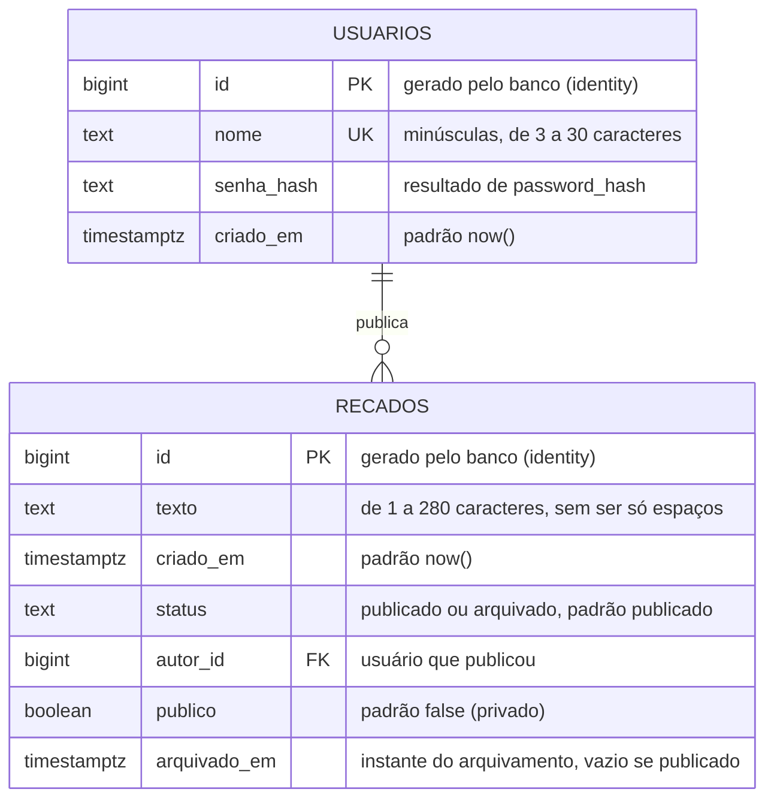
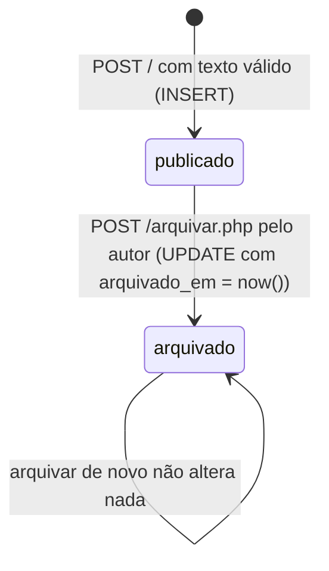

# Modelo de dados

O banco tem duas tabelas: `usuarios`, com as contas, e `recados`, em que cada
recado aponta para o usuário que o publicou. Duas informações ficam fora do
banco: a sessão de login, nos arquivos de sessão do PHP, e a preferência de
ordem do mural, no cookie `mini_mural_ordem` do navegador (decisões D20 e D10
em [decisoes.md](decisoes.md)).

## Diagrama



Cada usuário publica zero ou mais recados, e cada recado tem exatamente um
autor.

O que fica fora do banco também faz parte do estado da aplicação:

| Onde | Nome | Conteúdo | Padrão |
|---|---|---|---|
| Cookie do navegador | `mini_mural_sessao` | Identificador da sessão; os dados ficam no servidor | Criado na primeira visita |
| Arquivo de sessão no servidor | `$_SESSION` | `usuario` (id e nome) depois do login, e `csrf` (o token) | Vazio até o login |
| Cookie do navegador | `mini_mural_ordem` | `mais-recentes` ou `mais-antigos` | `mais-recentes` quando ausente ou desconhecido |

## Colunas de `usuarios`

| Coluna | Tipo | Regra | Quem garante |
|---|---|---|---|
| `id` | `bigint` | Único, gerado em sequência | `GENERATED ALWAYS AS IDENTITY` e `PRIMARY KEY` |
| `nome` | `text` | Minúsculas, de 3 a 30 caracteres entre letras sem acento, números, ponto, hífen e sublinhado; sem repetição | `normalizarNome()` e `validarCadastro()` no PHP, `UNIQUE` e o `CHECK` `usuario_nome_valido` |
| `senha_hash` | `text` | Hash bcrypt, nunca a senha | `password_hash()` em `criarUsuario()` |
| `criado_em` | `timestamptz` | Instante do cadastro | `DEFAULT now()` |

## Colunas de `recados`

| Coluna | Tipo | Regra | Quem garante |
|---|---|---|---|
| `id` | `bigint` | Único, gerado em sequência | `GENERATED ALWAYS AS IDENTITY` e `PRIMARY KEY` |
| `texto` | `text` | Não vazio depois de tirar espaços; até 280 caracteres | `validarRecado()` no PHP e os `CHECK` `recado_texto_preenchido` e `recado_texto_ate_280` |
| `criado_em` | `timestamptz` | Instante da gravação, com fuso | `DEFAULT now()` |
| `status` | `text` | `publicado` ou `arquivado` | `DEFAULT 'publicado'` e o `CHECK` `recado_status_valido` |
| `autor_id` | `bigint` | Um usuário que existe | `REFERENCES usuarios (id)`; o PHP grava o id do usuário logado |
| `publico` | `boolean` | `true` deixa ler sem login enquanto o recado está publicado | `DEFAULT false`; o PHP grava a caixa "Público" do formulário |
| `arquivado_em` | `timestamptz` | Preenchido se e só se o recado está arquivado | `now()` no `UPDATE` de `arquivarRecado()` e o `CHECK` `recado_arquivado_com_data` |

O `CHECK recado_arquivado_com_data` compara duas condições,
`(status = 'arquivado') = (arquivado_em IS NOT NULL)`. Ele recusa um recado
arquivado sem data e um recado publicado com data, então as duas colunas nunca
se contradizem.

O `REFERENCES` impede apagar um usuário que tem recados. O índice
`recados_criado_em` atende ao `ORDER BY criado_em` da lista. Com três recados
ele não faz diferença; com milhares, evita que o banco ordene a tabela inteira a
cada abertura do mural.

## Ciclo de vida de um recado

Um recado só anda em uma direção: a aplicação não oferece desarquivar nem
apagar. O campo `publico` é decidido na publicação e não muda depois. Só o
autor arquiva, e o arquivamento grava o instante em `arquivado_em`. Um recado
público arquivado deixa de ser lido sem login.



## No PHP

Cada linha chega ao PHP como um array associativo. Um recado tem as chaves
`id`, `texto`, `criado_em`, `status`, `arquivado_em`, `publico`, `autor_id` e
`autor`, esta com o nome de quem publicou, trazido pelo `JOIN`. As funções
`leituraPublica()` e `podeArquivar()` decidem, a partir desse array, quem lê e
quem arquiva. O usuário da sessão tem só `id` e `nome`; o
hash da senha não sai de `src/usuarios.php`. O projeto não tem classes
(decisão D5 em [decisoes.md](decisoes.md)).

## Consultas que a aplicação faz

Estas são todas as consultas do projeto. As de recados ficam em
`src/recados.php`, e as de usuários, em `src/usuarios.php`.

```sql
-- listarRecados(): ASC ou DESC sai de uma lista fechada, nunca do pedido
SELECT recados.id, recados.texto, recados.criado_em, recados.status,
       recados.arquivado_em, recados.publico, recados.autor_id,
       usuarios.nome AS autor
  FROM recados
  JOIN usuarios ON usuarios.id = recados.autor_id
 ORDER BY recados.criado_em DESC, recados.id DESC;

-- listarRecadosPublicos(): a mesma consulta, só com o que se lê sem login
SELECT ... WHERE recados.publico AND recados.status = 'publicado' ORDER BY ...;

-- buscarRecado(): as mesmas colunas e o mesmo JOIN
SELECT ... WHERE recados.id = :id;

-- publicarRecado()
INSERT INTO recados (texto, autor_id, publico)
VALUES (:texto, :autor_id, :publico) RETURNING id;

-- arquivarRecado(): o filtro por autor_id repete a conferência da página
UPDATE recados SET status = 'arquivado', arquivado_em = now()
 WHERE id = :id AND autor_id = :autor_id AND status = 'publicado';

-- conferirLogin()
SELECT id, nome, senha_hash FROM usuarios WHERE nome = :nome;

-- criarUsuario(): o erro 23505 (UNIQUE) quer dizer "nome já existe"
INSERT INTO usuarios (nome, senha_hash) VALUES (:nome, :senha_hash) RETURNING id, nome;
```

O desempate por `id` na ordenação garante uma ordem estável quando dois recados
têm o mesmo `criado_em`.
