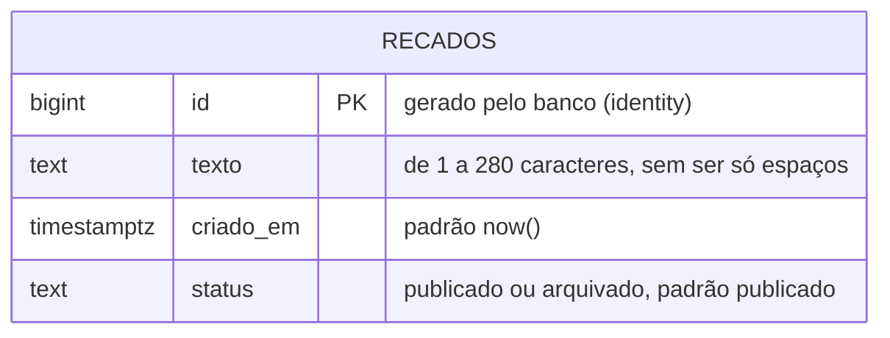
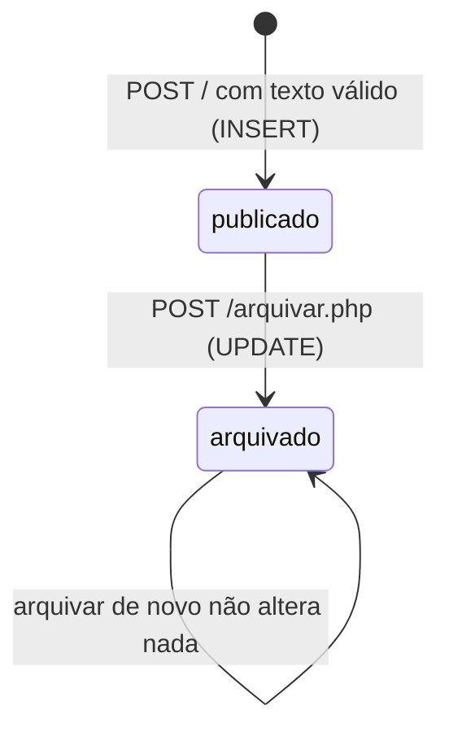

# Modelo de dados

O banco tem uma tabela, `recados`. A preferência de ordem do mural não fica no
banco: ela vive no cookie `mini_mural_ordem` do navegador (decisão D10 em
[decisoes.md](decisoes.md)).

## Diagrama



O cookie aparece fora do diagrama porque não é uma tabela, mas faz parte do
estado da aplicação:

| Onde | Nome | Valores | Padrão |
|---|---|---|---|
| Cookie do navegador | `mini_mural_ordem` | `mais-recentes`, `mais-antigos` | `mais-recentes` quando ausente ou desconhecido |

## Colunas

| Coluna | Tipo | Regra | Quem garante |
|---|---|---|---|
| `id` | `bigint` | Único, gerado em sequência | `GENERATED ALWAYS AS IDENTITY` e `PRIMARY KEY` |
| `texto` | `text` | Não vazio depois de tirar espaços; até 280 caracteres | `validarRecado()` no PHP e os `CHECK` `recado_texto_preenchido` e `recado_texto_ate_280` |
| `criado_em` | `timestamptz` | Instante da gravação, com fuso | `DEFAULT now()` |
| `status` | `text` | `publicado` ou `arquivado` | `DEFAULT 'publicado'` e o `CHECK` `recado_status_valido` |

O índice `recados_criado_em` atende ao `ORDER BY criado_em` da lista. Com três
recados ele não faz diferença; com milhares, evita que o banco ordene a tabela
inteira a cada abertura do mural.

## Ciclo de vida de um recado

Um recado só anda em uma direção: a aplicação não oferece desarquivar nem
apagar.



## No PHP

Cada linha da tabela chega ao PHP como um array associativo, com as mesmas
chaves das colunas: `id`, `texto`, `criado_em` e `status`. O projeto não tem
classe `Recado` (decisão D5 em [decisoes.md](decisoes.md)).

## Consultas que a aplicação faz

Estas são todas as consultas do projeto, todas em `src/recados.php`.

```sql
-- listarRecados(): ASC ou DESC sai de uma lista fechada, nunca do pedido
SELECT id, texto, criado_em, status FROM recados ORDER BY criado_em DESC, id DESC;

-- buscarRecado()
SELECT id, texto, criado_em, status FROM recados WHERE id = :id;

-- publicarRecado()
INSERT INTO recados (texto) VALUES (:texto) RETURNING id;

-- arquivarRecado()
UPDATE recados SET status = 'arquivado' WHERE id = :id AND status = 'publicado';
```

O desempate por `id` na ordenação garante uma ordem estável quando dois recados
têm o mesmo `criado_em`.
